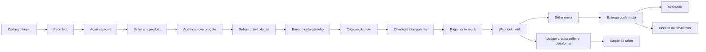
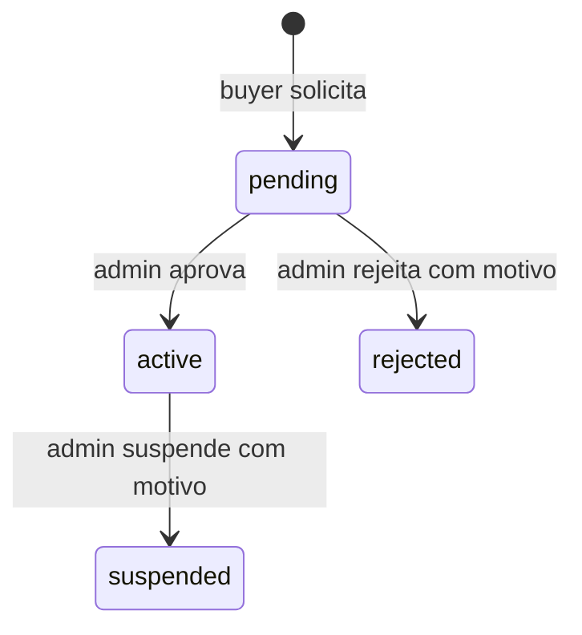
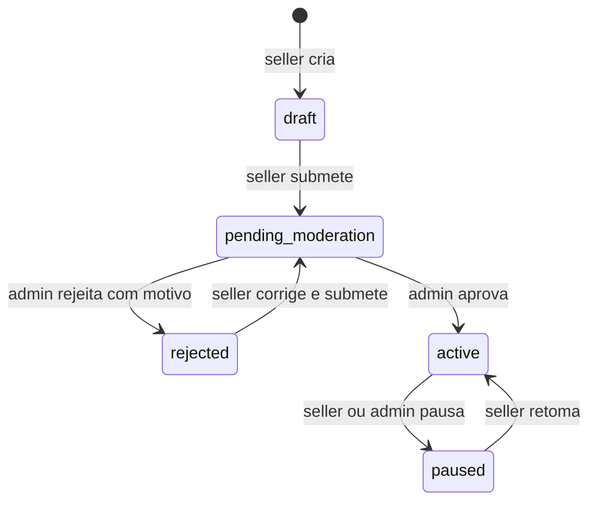
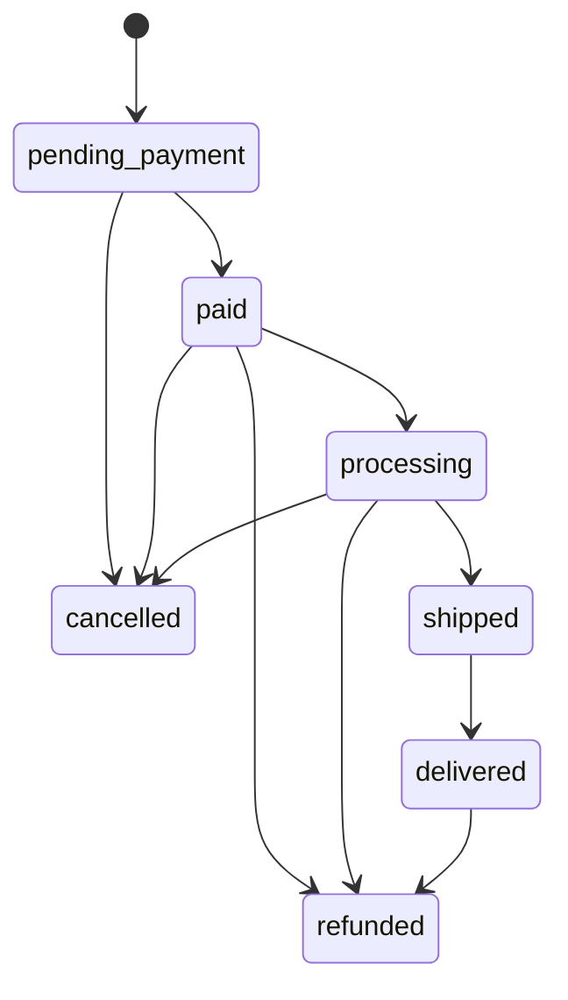
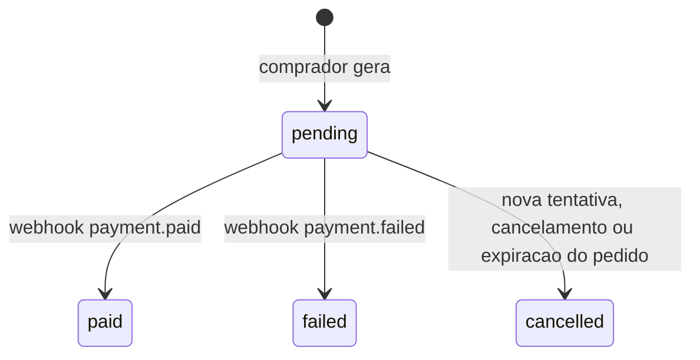
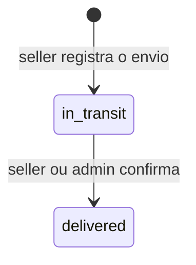
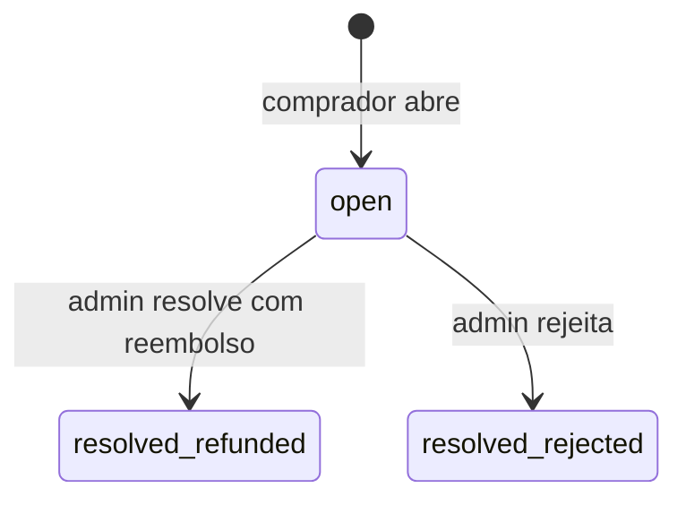
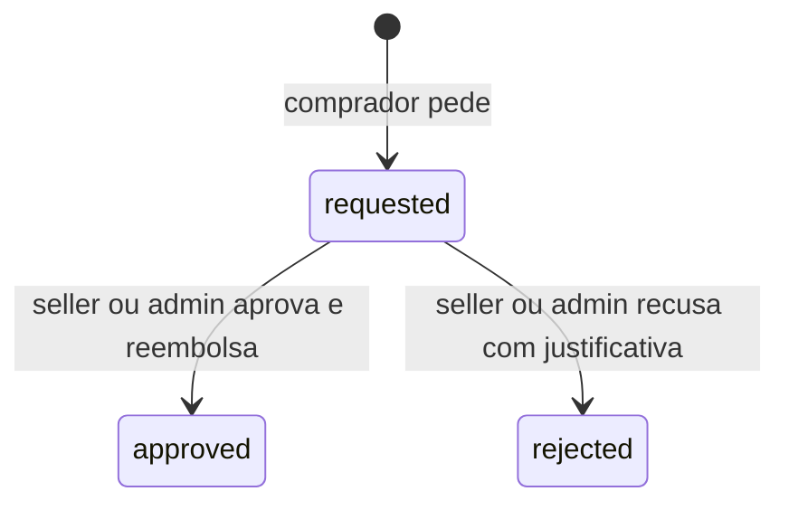

# Fluxos, estados e regras de negócio

Como o marketplace se comporta por dentro: máquinas de estado, regras de cada contexto, movimentação de dinheiro e estoque, autorização, configuração e auditoria. Descreve o código em `develop` em 20/10/2026.

Endpoints, corpos e códigos de resposta: [`api-referencia.md`](api-referencia.md).

---

## 1. Jornada completa



Todas as etapas têm teste de feature. A seção 10 do [roadmap](roadmap-implementacao-api.md) lista o teste de cada critério do "core pronto".

---

## 2. Papéis e autorização

### Papéis

| Papel | Como se obtém | Perde quando |
|-------|---------------|--------------|
| `buyer` | todo cadastro | nunca |
| `seller` | admin aprova a loja | loja rejeitada ou suspensa |
| `admin` | manualmente (não há seeder nem endpoint; ver README) | — |

Um usuário pode ser `buyer` e `seller` ao mesmo tempo. Comprar não exige loja.

### Camadas

1. **Token:** `auth:sanctum` + ability `access` (ou `refresh` no refresh).
2. **Papel:** middleware `role:seller` / `role:admin` (`EnsureUserHasRole`) nos prefixos `seller/*` e `admin/*`.
3. **Recurso:** Policy por model (`app/Policies/`). Controllers de buyer e seller checam a posse antes e respondem **404** para recurso de terceiros, para não revelar que existe.

### Matriz de Policies

| Policy | Regra principal |
|--------|-----------------|
| `StorePolicy` | pedir loja exige o papel `buyer`; dono ou admin vê; admin lista e decide |
| `CategoryPolicy` | escrita só admin |
| `ProductPolicy` | seller dono com loja `active` cria, edita, submete, gerencia imagens, pausa, retoma e exclui; admin vê, edita, pausa e modera qualquer um |
| `OfferPolicy` | seller dono com loja `active` cria, edita, pausa, retoma e exclui; a policy já autoriza admin a ver, editar e pausar (sem rotas admin ainda) |
| `AddressPolicy` | só o dono |
| `CartPolicy` / `CartItemPolicy` | só o dono do carrinho |
| `OrderPolicy` | comprador vê, cancela e paga os próprios pedidos; admin vê todos |
| `OrderSellerPolicy` | seller da loja vê, cancela e faz o envio; seller ou admin confirma entrega; admin reembolsa; comprador abre pós-venda |
| `PayoutPolicy` | seller solicita (a listagem do seller é restrita à própria loja); admin lista e processa |
| `ProductReviewPolicy` | só o comprador do item avalia |
| `DisputePolicy` | seller da loja responde; admin lista e resolve |
| `ReturnRequestPolicy` | seller da loja ou admin decide; admin lista |

---

## 3. Loja (`stores`)



- Uma loja por usuário, inclusive contando lojas rejeitadas ou excluídas: uma segunda solicitação responde 409.
- `document` (CPF 11 ou CNPJ 14 dígitos) é único; `slug` é gerado a partir do nome e desambiguado com sufixo.
- Aprovar concede o papel `seller`. Rejeitar ou suspender remove o papel.
- Loja suspensa: as ofertas dela saem do Buy Box, da reserva, do carrinho e do checkout; ela não solicita saque.
- `origin_cep` é o CEP de saída do frete. Sem ele, o frete usa `SHIPPING_DEFAULT_ORIGIN_CEP`.
- Não há reativação de loja suspensa nem nova solicitação após rejeição.

---

## 4. Catálogo

### Categorias

- Árvore com **no máximo 3 níveis**; mover uma categoria revalida ciclo e profundidade da subárvore (422).
- Exclusão é soft delete e é bloqueada se houver subcategorias ou produtos (409).
- Atributos (`category_attributes`): `code` único na categoria; `data_type` `string`, `integer`, `decimal`, `boolean` ou `enum`; `options` obrigatório para `enum`. Valores de atributo por produto ainda não existem (B2.4).

### Produto



- O seller só edita o conteúdo em `draft` ou `rejected`; o admin edita em qualquer estado.
- O seller exclui (soft delete) em `draft`, `rejected` ou `paused`; as imagens são apagadas do disco.
- Até 8 imagens (jpeg, jpg, png, webp; até 2 MB). A primeira é a capa (`position` 0); a reordenação precisa listar todas.
- Peso e medidas ficam no produto (valem para todos os sellers). Sem eles, o frete usa a embalagem padrão.
- Produto canônico **não tem preço nem estoque**: isso é da oferta.
- Busca pública: só produto `active` de loja `active`; filtros por texto (nome e descrição, sem diferenciar maiúsculas), categoria e loja.

---

## 5. Ofertas, Buy Box e estoque

### Oferta

- Uma oferta por loja e produto. O seller pode ofertar produto de outra loja: é assim que o mesmo item tem vários vendedores.
- `price` e `promotional_price` em reais (`decimal(12,2)`). O preço vigente (`currentPrice()`) é o promocional quando há promoção dentro da janela `promo_starts_at`–`promo_ends_at`; senão, `price`.
- Estados `active` ↔ `paused`. Exclusão (soft delete) só sem reservas ativas.
- `stock` pode ser alterado, mas nunca para menos que `reserved_stock` (409).

### Buy Box

Entre as ofertas `active`, de loja `active` e com estoque disponível, vence a de **menor preço vigente**; empate vai para **mais estoque disponível**; novo empate, para a **mais antiga**. A vencedora aparece em `buy_box` no detalhe do produto, e todas as elegíveis em `data.offers`.

### Reservas e estoque

```text
disponível = stock − reserved_stock

reservar  : reserved_stock += qtd                  (reserva active)
liberar   : reserved_stock −= qtd                  (reserva released)
consumir  : stock −= qtd ; reserved_stock −= qtd   (reserva committed)
repor     : stock += qtd                           (reembolso com devolução ao estoque)
```

Toda alteração acontece em transação com `lockForUpdate()` na oferta. Há teste com duas reservas concorrentes do último item: só uma passa.

| Origem da reserva | Criada em | Termina em |
|-------------------|-----------|------------|
| Avulsa (`POST /offers/{offer}/reservations`) | na hora, por 15 min | liberada pelo dono ou pelo comando `reservations:release-expired` |
| Pedido (checkout) | no checkout, ligada ao `order_id` | consumida quando o pagamento confirma; liberada no cancelamento ou na expiração do pedido |

Reservas de pedido **não** expiram pelo TTL de 15 minutos: seguem o prazo do pedido (`payment_due_at`). Assim, um pagamento que chega dentro do prazo sempre encontra a reserva para consumir.

---

## 6. Endereços e carrinho

### Endereços

- CEP em `#####-###` ou 8 dígitos, gravado só com dígitos; UF validada contra as 27 siglas.
- O primeiro endereço vira padrão. Só há um padrão por usuário; para trocar, define-se outro (não dá para desmarcar o atual).
- Excluir o padrão promove o endereço mais antigo restante.
- O pedido copia o endereço (`shipping_*` em `orders`); mudanças posteriores não afetam pedidos antigos.

### Carrinho

- Um carrinho por usuário, criado no primeiro acesso; uma linha por oferta (adicionar a mesma oferta soma a quantidade, até 999).
- Ao adicionar ou alterar: oferta `active`, loja `active`, produto `active` e estoque disponível suficiente; senão, 409.
- O carrinho não reserva estoque e não congela preço: os totais são recalculados com o preço vigente a cada leitura.

---

## 7. Frete

### Cotação

1. **Zona** pelo CEP de origem da loja e o de destino:
   - mesmos 3 primeiros dígitos → `local`;
   - mesmo primeiro dígito → `regional`;
   - demais → `national`.
2. **Peso cobrado por unidade** = maior entre o peso real e o volumétrico (comprimento × largura × altura em cm ÷ 6000, em kg). Produto sem dados usa a embalagem padrão (500 g, 16 × 11 × 6 cm). Multiplica pela quantidade e soma os itens da loja.
3. **Preço:** para cada modalidade, a menor faixa de `shipping_rate_rules` cuja `max_weight_grams` comporta o peso. Peso acima da maior faixa → a modalidade não aparece.

Tabela padrão (`ShippingRateRuleSeeder`), preço em reais e prazo em dias:

| Modalidade | Zona | até 1 kg | até 5 kg | até 30 kg | Prazo |
|------------|------|---------:|---------:|----------:|------:|
| `simulated_standard` | local | 12,90 | 19,90 | 34,90 | 3 |
| `simulated_standard` | regional | 18,90 | 27,90 | 49,90 | 5 |
| `simulated_standard` | national | 25,90 | 38,90 | 69,90 | 9 |
| `simulated_express` | local | 21,90 | 32,90 | 59,90 | 1 |
| `simulated_express` | regional | 29,90 | 44,90 | 79,90 | 2 |
| `simulated_express` | national | 39,90 | 59,90 | 109,90 | 4 |

### No checkout

- A cotação é refeita por loja dentro da transação. Se a modalidade pedida não atende alguma loja, o checkout inteiro falha com 409.
- Cada subpedido grava `shipping_cents`, `shipping_service_code`, `shipping_service_name`, `shipping_eta_days` e `shipping_quoted_at`. Mudanças posteriores na tabela não alteram pedidos já feitos.
- Não há regra "sem tabela = frete grátis": sem regra que atenda, o checkout falha.

---

## 8. Checkout

Uma única transação, nesta ordem:

1. Se já existe pedido do comprador com a mesma `Idempotency-Key`, devolve esse pedido (200), sem efeito colateral.
2. Trava o carrinho e os itens; carrinho vazio → 409.
3. Valida o endereço do próprio comprador (404 se for de outro).
4. Para cada item, trava a oferta e revalida oferta, loja e produto `active` e estoque disponível (409).
5. Converte o preço vigente para centavos (`unit_price_cents`).
6. Agrupa os itens por loja e cota o frete de cada grupo (seção 7).
7. Cria o pedido `pending_payment` com subtotal, frete, total, cópia do endereço e `payment_due_at` = agora + 60 min.
8. Cria um subpedido por loja e os itens com snapshot de nome, slug e preço unitário.
9. Reserva o estoque de cada item, ligando a reserva ao pedido.
10. Grava o histórico de status, esvazia o carrinho e registra auditoria.

Qualquer falha desfaz tudo. A unicidade `(buyer_id, idempotency_key)` também é garantida no banco, o que cobre duas requisições simultâneas com a mesma chave.

---

## 9. Pedido e subpedido

### Máquina de estados

A mesma tabela vale para `orders.status` e `order_sellers.status` (`OrderStateMachine`). Qualquer transição fora dela responde 409.



`cancelled` e `refunded` são terminais. Cada transição grava `order_status_histories` (de, para, ator, motivo); transições feitas pelo sistema ficam com ator nulo.

### Quem move cada transição

| Transição | Quem | Endpoint ou gatilho |
|-----------|------|---------------------|
| `pending_payment → paid` | sistema | webhook `payment.paid` |
| `pending_payment → cancelled` | comprador | `POST /orders/{order}/cancel` |
| `pending_payment → cancelled` | sistema | comando `orders:expire-unpaid` |
| `pending_payment` / `paid` / `processing` → `cancelled` (subpedido) | seller | `POST /seller/order-sellers/{id}/cancel`; se já pago, reembolsa o restante e repõe o estoque |
| `paid → processing` | seller | `.../processing`, ou automaticamente ao enviar direto de `paid` |
| `processing → shipped` | seller | `.../shipments` |
| `shipped → delivered` | seller ou admin | `.../deliver` |
| `* → refunded` (subpedido) | admin, disputa ou devolução | reembolso que zera o saldo do subpedido |

### Como o pedido pai acompanha os subpedidos

- **Fulfillment:** o pedido vai para a etapa do subpedido ativo **mais atrasado**. Só fica `shipped` quando todos os subpedidos ativos foram enviados, e `delivered` quando todos foram entregues. Subpedidos cancelados ou reembolsados não seguram o pedido.
- **Encerramento:** se todos os subpedidos forem cancelados, o pedido é cancelado; se todos estiverem cancelados ou reembolsados (com ao menos um reembolsado), o pedido vira `refunded`.

### Prazo de pagamento e expiração

| Evento | `payment_due_at` |
|--------|------------------|
| Checkout | agora + `ORDERS_UNPAID_TTL_MINUTES` (60) |
| Gerar Pix | estende até a validade do QR (agora + 30 min) |
| Gerar boleto | estende até o fim do dia de vencimento (agora + 3 dias) |
| Gerar cartão | estende para agora + 60 min |

O prazo só é estendido, nunca encurtado. O comando `orders:expire-unpaid` (a cada minuto) cancela pedidos `pending_payment` vencidos com o motivo "Prazo de pagamento expirado.": cancela os subpedidos, libera as reservas e cancela os pagamentos pendentes. Um pagamento confirmado depois disso é ignorado (`payment_not_pending`), sem lançamento no ledger nem baixa de estoque.

---

## 10. Pagamento (mock)



- Só pedidos `pending_payment` recebem pagamento. O valor é a soma dos subpedidos não cancelados.
- Uma nova tentativa cancela a pendente anterior; o banco garante no máximo um pagamento aberto por pedido.
- Idempotência por `Idempotency-Key` por pedido; reusar a chave com outro método → 409.
- O webhook exige o segredo `X-Mock-Webhook-Secret` (comparação em tempo constante); com `PAYMENTS_MOCK_WEBHOOK_SECRET` vazio, todo webhook é recusado.
- O evento é gravado em `payment_webhook_events` (único por `event_id`) e processado pelo job `ProcessPaymentWebhookEvent`. Evento repetido não tem efeito.
- Ao confirmar: pagamento `paid`, pedido e subpedidos `paid`, reservas consumidas (baixa de estoque) e lançamentos de venda no ledger.
- Pagamento falho mantém o pedido em `pending_payment`, permitindo nova tentativa.
- Nenhum dado de cartão é recebido ou armazenado; o cartão é só um `checkout_url` simulado.

---

## 11. Comissão, ledger, reembolso e saque

### Comissão

- Regra vigente em `platform_fee_rules`: entre as que estão em vigor no momento do pagamento (`starts_at` ≤ agora e `ends_at` vazio ou futuro), a de `starts_at` mais recente. Sem regra vigente, usa `PLATFORM_COMMISSION_BPS` (padrão 1000 = 10%).
- Tipos: `percentage` (bps, arredondamento meio para cima ao centavo) ou `fixed` (limitada ao valor da base).
- **Base = subtotal de itens do subpedido.** O frete não paga comissão e vai inteiro para o seller.

### Ledger

Tabela `ledger_entries`, append-only: UPDATE e DELETE são bloqueados no model e por trigger no Postgres. Saldo é sempre soma, nunca um campo editável. Cada lançamento tem `idempotency_key` única.

| Evento | Conta seller | Conta plataforma |
|--------|--------------|------------------|
| Pagamento confirmado (`sale` / `commission`) | + (total do subpedido − comissão) | + comissão |
| Reembolso (`refund` / `commission_refund`) | − (reembolso − parte da comissão) | − parte proporcional da comissão |
| Saque pago (`payout`) | − valor do saque | — |

Exemplo com um subpedido de R$ 99,90 sem frete e comissão de 10%:

| Momento | Seller | Plataforma |
|---------|-------:|-----------:|
| Pago | +8.991 | +999 |
| Reembolso parcial de 3.000 | −2.700 | −300 |
| Saldo | 6.291 | 699 |

O reembolso que encerra o subpedido estorna exatamente o que sobrou, para o arredondamento nunca deixar resíduo.

### Reembolso

- Valor entre 1 e o restante reembolsável do subpedido (`total_cents` − já reembolsado); sem valor, reembolsa tudo.
- Só para subpedido com pagamento confirmado e venda no ledger.
- Repõe o estoque apenas se for o reembolso total e o subpedido estiver em `paid` ou `processing` (a mercadoria não saiu). Depois do envio, não repõe.
- Reembolso total move o subpedido para `refunded` quando a transição é permitida (de `paid`, `processing` ou `delivered`); reembolso parcial mantém o status.
- Origens: admin (`/admin/order-sellers/{id}/refunds`), cancelamento do seller após pagamento, disputa resolvida a favor do comprador, devolução aprovada.

### Saldo e saque

```text
balance_cents        = soma dos lançamentos da loja
pending_payout_cents = saques requested
held_cents           = saldo de subpedidos com disputa aberta ou devolução pendente
available_cents      = balance − pending_payout − held
```

- O seller com loja `active` pede saque de até `available_cents` (409 acima disso).
- Admin marca `paid` (gera o lançamento negativo) ou `failed` (o valor volta ao disponível, sem lançamento).
- Um reembolso depois de um saque pode deixar o saldo negativo; nesse caso nenhum saque novo passa até o saldo voltar a ser positivo.

---

## 12. Envio



- Um envio por subpedido. Código de rastreio `SM` + 9 dígitos + `BR`, único; transportadora `simulated`.
- `estimated_delivery_at` = data de envio + prazo cotado no checkout.
- O comprador vê o envio dentro do próprio pedido; o seller, no subpedido.
- Não há job de entrega automática.

---

## 13. Avaliações

- Uma avaliação por item de pedido (`order_item_id` único); comprar de novo permite avaliar de novo.
- Só o comprador, só com o subpedido `delivered`, e nunca o dono da loja avaliando produto da própria loja.
- Nota de 1 a 5 validada no request e por `CHECK` no banco. A avaliação não é editável nem removível.
- Médias calculadas por consulta: `rating { average, count }` no produto (avaliações dele) e na loja (avaliações de todos os produtos dela).
- A listagem pública mostra só o primeiro nome do autor.

---

## 14. Disputas e devoluções

### Quem pode abrir

Só o comprador do subpedido, com o subpedido `delivered`, até 7 dias após `shipments.delivered_at`. Cada subpedido aceita no máximo uma disputa e uma devolução ao longo da vida, e nunca as duas em andamento ao mesmo tempo.

### Disputa



- Motivos: `not_received`, `not_as_described`, `damaged`, `other`.
- O seller pode registrar uma resposta enquanto a disputa está aberta; só o admin decide.
- Resolução com reembolso usa o valor informado ou o restante inteiro, sem repor estoque.

### Devolução



- O valor pedido fica entre 1 e o restante reembolsável.
- Aprovar dispara o reembolso desse valor, sem reposição automática de estoque (o seller ajusta a oferta).

### Efeito no saque

Enquanto a disputa está `open` ou a devolução está `requested`, o saldo daquele subpedido entra em `held_cents` e sai do disponível. A trava cai quando o caso é decidido, em qualquer direção.

---

## 15. Tarefas agendadas e fila

| O quê | Onde roda | Frequência | Efeito |
|-------|-----------|-----------|--------|
| `orders:expire-unpaid` | serviço `scheduler` (`schedule:work`) | a cada minuto, sem sobreposição | cancela pedidos com `payment_due_at` vencido (até 200 por execução) |
| `reservations:release-expired` | serviço `scheduler` | a cada minuto, sem sobreposição | libera reservas avulsas vencidas |
| `sanctum:prune-expired --hours=24` | serviço `scheduler` | diário | apaga tokens vencidos há mais de 24 h |
| `ProcessPaymentWebhookEvent` | serviço `worker` (`queue:work redis`) | por evento | aplica o webhook; 5 tentativas com espera de 5 s, 30 s, 2 min e 5 min |

Nos testes a fila roda de forma síncrona (`QUEUE_CONNECTION=sync`).

---

## 16. Configuração de domínio

| Variável | Padrão | Efeito |
|----------|--------|--------|
| `PAYMENTS_MOCK_WEBHOOK_SECRET` | vazio | segredo do webhook; vazio recusa todos |
| `PAYMENTS_MOCK_PIX_TTL_MINUTES` | 30 | validade do QR Pix e extensão do prazo do pedido |
| `PAYMENTS_MOCK_BOLETO_DUE_DAYS` | 3 | vencimento do boleto |
| `PAYMENTS_MOCK_CHECKOUT_URL` | `https://mock-payments.local/checkout` | base do link de cartão |
| `PLATFORM_COMMISSION_BPS` | 1000 | comissão quando não há regra vigente (10%) |
| `ORDERS_UNPAID_TTL_MINUTES` | 60 | prazo inicial de pagamento e extensão no cartão |
| `SHIPPING_DEFAULT_SERVICE` | `simulated_standard` | modalidade usada quando o checkout não informa |
| `SHIPPING_DEFAULT_ORIGIN_CEP` | `01310100` | origem do frete para loja sem `origin_cep` |
| `POST_SALE_DISPUTE_WINDOW_DAYS` | 7 | janela para abrir disputa |
| `POST_SALE_RETURN_WINDOW_DAYS` | 7 | janela para pedir devolução |
| `MAIL_MAILER` | `log` | `resend` envia pela Resend; `log` grava em `storage/logs` |
| `RESEND_API_KEY` | vazio | chave da API da Resend |
| `MAIL_FROM_ADDRESS` | `onboarding@resend.dev` | remetente; o domínio precisa estar verificado na Resend para enviar a qualquer destinatário |
| `FRONTEND_URL` | `http://localhost:3000` | base do link de redefinição de senha |
| `GOOGLE_CLIENT_ID` / `GOOGLE_CLIENT_SECRET` | vazio | credenciais OAuth; vazias, o login com Google responde 503 |
| `GOOGLE_REDIRECT_URI` | `${APP_URL}/api/v1/auth/google/callback` | precisa estar cadastrada no Google Cloud |

Valores fixos no código: embalagem padrão e divisor volumétrico (`config/shipping.php`), TTL de 15 min da reserva avulsa (`InventoryService`), limite de 8 imagens (`ProductService`), validade dos tokens (`AuthService`).

---

## 17. Auditoria

`audit_logs` grava ator (morph, nulo quando é o sistema), recurso (morph), ação, payload, IP, user agent e data. Nunca grava token, senha, dado de cartão ou caminho absoluto de arquivo.

| Contexto | Ações |
|----------|-------|
| Auth | `auth.register`, `auth.login`, `auth.logout`, `auth.refresh`, `auth.refresh.invalid`, `auth.unauthenticated`, `auth.unauthorized`, `auth.password_reset_requested`, `auth.password_reset`, `auth.email_verified`, `auth.email_verification_resent`, `auth.google_register`, `auth.google_login`, `auth.google_linked` |
| Loja | `store.requested`, `store.approved`, `store.rejected`, `store.suspended` |
| Categoria | `category.created`, `category.updated`, `category.deleted`, `category.attribute.created`, `category.attribute.updated`, `category.attribute.deleted` |
| Produto | `product.created`, `product.updated`, `product.submitted`, `product.approved`, `product.rejected`, `product.paused`, `product.resumed`, `product.deleted`, `product.image.created`, `product.image.deleted`, `product.image.reordered` |
| Oferta | `offer.created`, `offer.updated`, `offer.paused`, `offer.resumed`, `offer.deleted` |
| Endereço | `address.created`, `address.updated`, `address.deleted`, `address.default_set` |
| Pedido | `order.checkout.created`, `order.cancelled_by_buyer`, `order.expired_unpaid`, `order_seller.cancelled_by_seller`, `order_seller.processing_started`, `order_seller.shipped`, `order_seller.delivered` |
| Dinheiro | `payment.intent_created`, `payment.webhook_processed`, `order_seller.refunded_by_admin`, `order_seller.refunded_by_dispute`, `order_seller.refunded_by_return`, `payout.requested`, `payout.marked_paid`, `payout.marked_failed` |
| Pós-venda | `product_review.created`, `dispute.opened`, `dispute.seller_responded`, `dispute.resolved`, `return_request.created`, `return_request.approved`, `return_request.rejected` |
