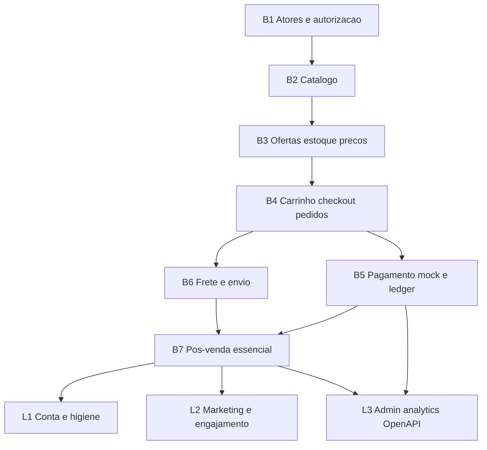

# Roadmap de Implementação — Core de Negócio do Marketplace

Documento vivo focado em **regras de negócio do marketplace**. Conta (recuperação de senha, verificação de e-mail, login social, etc.) só entra **depois** do fluxo comprar/vender estar fechado de ponta a ponta.

**Backlog técnico quebrado em itens:** [`roadmap-backlog-tecnico.md`](roadmap-backlog-tecnico.md) (IDs `B*.*.**`, schema, endpoints, testes, status).

**Stack:** PHP 8.4 · Laravel 12 · Sanctum · PostgreSQL · Redis  
**API:** `/api/v1`  
**Git:** `feature/*` → `develop` → `main`  
**Objetivo:** portfólio / aprendizado — priorizar domínio, não features de conta

---

## 1. Princípio de priorização

### O que é “core”

Core = tudo que responde a estas perguntas de negócio:

1. Quem vende e quem compra?
2. O que está à venda (catálogo + oferta + estoque + preço)?
3. Como o comprador fecha um pedido (carrinho → checkout → pedido)?
4. Como o dinheiro é (simulado) liquidado (pagamento → comissão → ledger)?
5. Como o pedido chega ao comprador (frete simulado + status de envio)?

### O que NÃO é core agora

Adiar conscientemente até o core estar estável:

| Item | Motivo do adiamento |
|------|---------------------|
| Verificação de e-mail | Não bloqueia comprar/vender no MVP de portfólio |
| Recuperação / reset de senha | Higiene de conta; não altera domínio |
| Login social | Atalho de auth; zero regra de marketplace |
| Cupons, ads, wishlist, chat | Engajamento; depende de pedido/catálogo maduros |
| OpenAPI / webhooks seller | Contrato externo; vem após o domínio existir |
| Gateway / Correios reais | Fora de escopo; mock basta para provar regras |

**Regra:** se a feature não muda preço, estoque, pedido, pagamento ou envio, ela espera.

---

## 2. Visão do produto (decisões fixas)

| Tema | Decisão |
|------|---------|
| Modelo | Híbrido: a **plataforma** também vende + **sellers** terceiros |
| Cobrança | Plataforma cobra o comprador e **repassa** ao seller (split + comissão) |
| Pagamento | Apenas **mock** (Pix / cartão / boleto simulados) |
| Frete | Tabelado interno **simulado** (peso, dimensões, CEP) |
| Geografia | Somente Brasil |
| Público | B2C (B2B pode reutilizar o mesmo user; regras B2B avançadas depois) |
| Papéis | `buyer`, `seller`, `admin` — user pode ser **buyer + seller** |
| Onboarding seller | Solicitação + aprovação **manual** (KYC enxuto) |
| Carrinho | Somente autenticado (sem guest) |
| IDs | UUID |
| Soft delete | Em recursos de domínio (exceto audit/ledger append-only) |
| Paginação | Cursor |

### Jornada mínima de sucesso (definição de “core pronto”)

```text
Buyer cadastrado
  → navega catálogo / vê ofertas de 2+ sellers no mesmo produto
  → adiciona ao carrinho
  → checkout (endereço + frete simulado)
  → pedido multi-seller em pending_payment
  → pagamento mock confirma
  → pedido paid; estoque baixado; ledger credita sellers e comissão
  → seller marca envio; buyer vê tracking simulado
  → pedido delivered
```

Enquanto essa jornada não existir com testes, **não** investir em e-mail verify / reset / social.

---

## 3. Estado atual do repositório

### Fundação (pré-requisito)

- Auth Sanctum (register, login, logout, refresh) com abilities `access` / `refresh`
- User UUID + soft delete + CPF/telefone + `Password::defaults()`
- Roles (`roles` / `role_user`) + enum `RoleName`
- Audit log, erros JSON, cursor pagination, Redis + worker, testes de auth
- Docker: app, postgres, redis, worker + `compose.test.yml`
- Branch `develop` como integração; features nascem a partir dela

### Domínio já entregue em `develop` / `main`

| Fase | Entrega |
|------|---------|
| **B1** | Loja seller: solicitar / aprovar / rejeitar / suspender; role seller na aprovação; Policies + `role` middleware |
| **B2** | Categorias + atributos; produtos + imagens + moderação; vitrine `GET /stores/{slug}`; busca pública `q`/categoria/loja |

### Em andamento

| Fase | Branch | Foco |
|------|--------|------|
| **B3** | `feature/b3-offers-inventory` | Ofertas, estoque, Buy Box, reservas |

### Próximo após merge da B3

**B4** — carrinho, endereços, checkout idempotente, pedidos multi-seller + FSM.

Detalhamento item a item: [`roadmap-backlog-tecnico.md`](roadmap-backlog-tecnico.md).

Não reabrir fundação salvo bug bloqueante.

---

## 4. Diagrama — ordem do core



- **B1–B6** = caminho crítico do negócio  
- **B7** = confiança mínima (review + disputa enxuta)  
- **L\*** = later (conta, marketing, polish)

---

## 5. Fases de negócio (detalhadas)

---

### B1 — Atores, papéis e autorização de domínio

**Objetivo de negócio:** garantir que cada ação do marketplace seja feita pelo ator certo — comprador, vendedor aprovado ou admin — sem ainda depender de e-mail verificado.

#### Problema que resolve

Sem papéis claros, qualquer user autenticado poderia criar oferta, aprovar seller ou ver dados de outro. O marketplace deixa de ser multi-ator.

#### Regras de negócio (detalhe)

1. **Todo cadastro cria um `buyer`.** Comprar não exige papel seller.
2. **Um user pode acumular `buyer` + `seller`.** Vender não remove a capacidade de comprar.
3. **`admin` é exclusivo de operação.** Não se autoatribui; nasce via seeder/ação privilegiada.
4. **Seller só opera catálogo/estoque/pedidos de venda após perfil `approved`.** Status `pending` / `rejected` / `suspended` bloqueiam escrita de ofertas e resposta a pedidos.
5. **Solicitar seller** exige dados mínimos de negócio (nome da loja, documento, dados bancários mock). Admin aprova ou rejeita com motivo.
6. **KYC nesta fase é enxuto:** metadados + arquivo no storage + status. Não precisa OCR nem bureau. Objetivo é treinar o fluxo de aprovação, não compliance bancário real.
7. **Autorização em Policy/Gate**, nunca só no front. Token Sanctum prova identidade; role prova permissão de domínio.
8. **Audit log** em: atribuição de role, approve/reject seller, suspensão.

#### O que entregar

- Seed das roles `buyer`, `seller`, `admin`
- Register já associa `buyer`
- Endpoints: solicitar seller, admin listar/aprovar/rejeitar, `GET /me` com roles + status do seller profile
- Middleware `role:seller|admin` + Policies base (`SellerProfilePolicy`, etc.)
- Model `SellerProfile` (status, store_name, documentos refs)

#### Entidades

| Entidade | Campos-chave de negócio |
|----------|-------------------------|
| `roles` / `role_user` | `name` único |
| `seller_profiles` | `user_id`, `status`, `store_name`, `rejection_reason`, timestamps de decisão |
| `kyc_documents` | `seller_profile_id`, `type`, `path`, `status` (sem logar arquivo) |

#### Fora desta fase

- Verificação de e-mail obrigatória
- Reset de senha
- Social login
- Permissions granulares tipo Spatie (só 3 roles bastam)

#### Critérios de pronto

- [ ] User novo sempre tem `buyer`
- [ ] Seller pendente **não** cria oferta (403)
- [ ] Admin aprova → user passa a `hasRole(seller)` e pode criar oferta
- [ ] Buyer não acessa rotas admin
- [ ] Feature tests de papel / isolamento

#### Cuidados

Autorização (IDOR), LGPD em documentos KYC, não vazar path interno de arquivo.

---

### B2 — Catálogo (descoberta do que se vende)

**Objetivo de negócio:** o comprador encontra produtos; o seller (ou a plataforma) publica anúncios coerentes com categorias.

#### Problema que resolve

Sem catálogo estruturado não há Buy Box, filtros nem moderação. “Produto” misturado com “oferta do seller” gera preço e estoque inconsistentes depois.

#### Conceitos (importante separar)

| Conceito | Significado |
|----------|-------------|
| **Produto canônico** | O “o quê” (ex.: “Notebook X 16GB”) — identidade de catálogo |
| **Oferta** | O “quem vende e por quanto” — entra na **B3** |
| **Categoria** | Árvore de navegação + atributos esperados |
| **Loja** | Vitrine pública do seller |

Nesta fase o foco é **produto + categoria + mídia + moderação**. Preço/estoque ficam na B3, mesmo que o CRUD de produto já exista.

#### Regras de negócio (detalhe)

1. Categorias são **hierárquicas** (pai/filho). Admin gerencia a árvore.
2. Categoria pode declarar **atributos** (ex.: “memória RAM”, “cor”) usados em filtros e no formulário do produto.
3. Seller cria produto em `draft`. Só entra na busca pública em `active` após regras de moderação:
   - Opção A (MVP): auto-publish se seller já `approved`
   - Opção B: admin precisa aprovar (`pending_moderation` → `active` / `rejected`)
4. Produto `paused` ou `rejected` **não** aparece em listagem pública nem aceita nova compra (ofertas herdam isso na B3).
5. Seller só edita produtos da própria loja; admin edita qualquer um e pode rejeitar com motivo.
6. Plataforma pode ter produtos próprios (seller “platform” ou flag `is_platform`) — mesmo modelo.
7. Imagens: ordenação (capa = primeira), limite por produto, processamento assíncrono opcional (resize) via fila.
8. Soft delete de produto **não apaga** histórico futuro de pedidos (pedidos guardam snapshot na B4).

#### O que entregar

- CRUD admin de categorias (+ atributos)
- CRUD seller/admin de produtos + upload de imagens
- Loja pública do seller (`GET /stores/{slug}`)
- Busca pública: texto, categoria, seller; ordenação (relevância simples / mais recentes); cursor
- Moderação admin (se opção B)

#### Entidades

| Entidade | Papel |
|----------|-------|
| `categories` | árvore (`parent_id`) |
| `category_attributes` | definição de atributos |
| `products` | canônico + status + `seller_id` ou `store_id` |
| `product_images` | paths + `position` |
| `stores` | perfil público (pode ser 1:1 com `seller_profiles`) |

#### Critérios de pronto

- [ ] Comprador lista/detalha produtos ativos sem auth
- [ ] Dois sellers autenticados não editam o produto um do outro
- [ ] Produto rejeitado/pausado some da busca
- [ ] Seed com categorias e alguns produtos para demo

#### Cuidados

N+1 em listagens, autorização por ownership, storage sem path absoluto em JSON.

---

### B3 — Ofertas, estoque e preços (Buy Box)

**Objetivo de negócio:** o mesmo produto pode ser vendido por vários sellers, cada um com preço e estoque próprios; o sistema reserva estoque com segurança.

#### Problema que resolve

Preço no produto canônico impede multi-seller. Estoque sem reserva gera oversell no checkout.

#### Regras de negócio (detalhe)

1. **Oferta (`offer`)** pertence a um seller + produto (ou variante/SKU).
2. Campos mínimos: `price`, `promotional_price` (opcional), `promo_starts_at` / `promo_ends_at`, `stock`, `reserved_stock` (ou tabela de reservas), `status` (`active` / `paused`).
3. **Preço exibido** = promocional vigente se válido; senão `price`.
4. **Buy Box (regra MVP documentada):** entre ofertas `active` com estoque disponível (`stock - reserved > 0`), escolher a de **menor preço vigente**; empate → maior estoque; empate → mais antiga. Reputação entra depois (B7).
5. Oferta `paused` ou seller `suspended` não entra no Buy Box nem no carrinho.
6. **Variantes/SKUs** (cor, tamanho): produto pai + variantes; oferta aponta para a variante. Se MVP apertar, começar sem variante e só `offers` no produto — mas modelar a extensão desde o início evita refactor.
7. **Nunca** alterar estoque fora de transação. Dois checkouts concorrentes não podem reservar a mesma unidade.
8. Preço da vitrine **não** é o preço cobrado depois: na B4 o pedido **congela** o valor no item.
9. Plataforma vende com a mesma entidade `offer` (seller platform).

#### O que entregar

- CRUD de ofertas do seller
- Endpoint público de detalhe do produto com lista de ofertas + oferta vencedora
- Serviço de inventário: `reserve`, `release`, `commit` (baixa definitiva)
- Teste de concorrência (dois processos tentando reservar o último item)

#### Entidades

| Entidade | Papel |
|----------|-------|
| `product_variants` | opcional no MVP, recomendado |
| `offers` | preço + estoque + seller |
| `inventory_reservations` | `offer_id`, `qty`, `cart_id`/`user_id`, `expires_at` |

#### Critérios de pronto

- [ ] Mesmo produto com ≥ 2 ofertas de sellers diferentes
- [ ] Buy Box retorna oferta documentada pela regra
- [ ] Reserva impede oversell (teste automatizado)
- [ ] Oferta pausada não é comprável

#### Cuidados

Concorrência (`lockForUpdate` / unique constraint), consistência `stock` vs `reserved`, não vazar custo interno.

---

### B4 — Carrinho, checkout e pedidos (coração do marketplace)

**Objetivo de negócio:** transformar intenções de compra em um pedido multi-seller com preço histórico e máquina de estados explícita.

#### Problema que resolve

Sem snapshot de preço/nome/SKU, mudança de catálogo altera pedidos passados. Sem subpedidos, um seller atrasa e “prende” o pedido inteiro de outro.

#### Regras de negócio (detalhe)

**Carrinho**

1. Somente user autenticado (`buyer`).
2. Item do carrinho referencia `offer_id` + quantidade.
3. Ao adicionar/atualizar: validar oferta ativa, seller aprovado, estoque disponível (considerando reservas).
4. Carrinho pode misturar ofertas de vários sellers.

**Endereço**

5. User mantém endereços; checkout escolhe um (ou cria no ato).
6. Snapshot do endereço vai para o pedido (mudança futura do cadastro não altera pedido antigo).

**Checkout (atômico)**

7. Em **uma** `DB::transaction`:
   - revalidar cada oferta (status, preço vigente, seller)
   - reservar estoque
   - criar `order` + `order_sellers` (um por seller) + `order_items`
   - gravar snapshots: nome, SKU, unit_price, quantity, seller_id
   - limpar carrinho (ou marcar itens convertidos)
8. Idempotência: header/chave `Idempotency-Key` ou hash `(user_id + cart_version)` evita pedido duplicado.
9. Estoque insuficiente → **409** (ou 422 de negócio), nada parcial commitado.

**Pedido multi-seller**

10. `order` = agregador do comprador (total, endereço, status macro).
11. `order_seller` = unidade operacional do seller (status próprio, frete próprio na B6, pagamento rateado na B5).
12. Item sempre pertence a um `order_seller`.

**FSM (exemplo mínimo — documentar e testar cada transição)**

```text
order / order_seller:
  pending_payment
    → paid
    → cancelled

  paid
    → processing
    → cancelled (regras restritas)
    → refunded (via B5)

  processing
    → shipped
    → cancelled (regras restritas)

  shipped
    → delivered

  delivered = terminal feliz
  cancelled / refunded = terminais
```

13. **Quem cancela o quê:**
    - Buyer: só em `pending_payment` (e talvez `paid` antes de `shipped`, se regra permitir — documentar)
    - Seller: pode cancelar seu `order_seller` em estados iniciais (estoque volta)
    - Admin: pode forçar com audit log
14. Transição inválida → **409**, nunca “set status” livre no controller.
15. Dados fiscais **simulados** no pedido (CPF/CNPJ do buyer já no user; campos fiscais mock no order). Sem NFS-e.

#### O que entregar

- CRUD carrinho + endereços
- `POST /checkout` idempotente
- Consulta de pedidos (buyer vê os seus; seller vê `order_sellers` dele; admin vê tudo)
- Cancelamento conforme FSM
- Histórico de status (`order_status_histories`)

#### Entidades

| Entidade | Papel |
|----------|-------|
| `carts` / `cart_items` | intenção de compra |
| `addresses` | cadastro do buyer |
| `orders` | pedido pai |
| `order_sellers` | subpedido |
| `order_items` | linha com snapshot |
| `order_status_histories` | auditoria de transição |

#### Critérios de pronto

- [ ] Checkout cria 1 order com N subpedidos quando há N sellers
- [ ] Preço no item ≠ preço atual da offer após alteração posterior
- [ ] FSM coberta por testes (transições válidas e inválidas)
- [ ] Estoque reservado no checkout; liberado no cancelamento pré-pagamento

#### Cuidados

Transação, race condition, IDOR (seller A não vê subpedido de B), LGPD no endereço.

---

### B5 — Pagamento mock, comissão e ledger

**Objetivo de negócio:** provar o modelo financeiro do marketplace (split + comissão) sem gateway real.

#### Problema que resolve

Sem ledger, “saldo do seller” vira número editável e inconsistente. Sem idempotência de webhook, o mesmo pagamento confirma duas vezes.

#### Regras de negócio (detalhe)

1. Buyer inicia pagamento no `order` (`pix` | `credit_card` | `boleto`) → API devolve payload **mock** (QR fake, linha digitável fake, etc.).
2. Confirmação chega por **webhook simulado** (Job). Só então o pedido/subpedidos vão para `paid`.
3. **Idempotência:** `payment_intent_id` / `idempotency_key` únicos; evento duplicado não gera segundo crédito.
4. Ao pagar:
   - commit da reserva de estoque (baixa definitiva)
   - gerar `ledger_entries`: crédito seller (valor itens − comissão), crédito plataforma (comissão), por subpedido
5. Comissão: regra configurável (ex.: % global MVP; depois por categoria).
6. Reembolso total/parcial:
   - estorna ledger (novas entradas negativas/contrárias — append-only)
   - devolve estoque se ainda fizer sentido pelo estado do envio
   - atualiza status para `refunded` / parcial documentado
7. **Payout:** seller solicita saque do saldo disponível (soma do ledger − saques já pagos). Status `requested` → `paid` / `failed` (mock).
8. Ledger é **append-only**. Saldo = soma; nunca `UPDATE balance`.
9. Logs: nunca PAN/CVV; mesmo em mock, não inventar cartão real.

#### O que entregar

- `POST /orders/{id}/payments`
- `POST /webhooks/payments/mock` (protegido por secret de teste)
- Reembolso admin/buyer conforme regra
- Consulta de saldo + request payout (seller)
- Config de comissão

#### Entidades

| Entidade | Papel |
|----------|-------|
| `payments` | intenção + status |
| `payment_webhook_events` | raw + processed_at |
| `refunds` | valor + motivo |
| `ledger_entries` | movimento imutável |
| `payouts` | saque |
| `platform_fee_rules` | % / valor |

#### Critérios de pronto

- [ ] Fluxo pending_payment → paid via webhook mock
- [ ] Webhook duplicado é no-op seguro
- [ ] Comissão e créditos batem com o total do pedido
- [ ] Reembolso reflete no ledger
- [ ] Feature tests dos 3 métodos mock

#### Cuidados

Integridade financeira, autorização de webhook, não vazar dados de pagamento.

---

### B6 — Frete simulado e envio

**Objetivo de negócio:** cotar frete no checkout e acompanhar envio por subpedido, sem transportadora real.

#### Regras de negócio (detalhe)

1. Cotação por **subpedido** (cada seller pode ter origem/CEP e peso diferentes).
2. Entrada do cálculo: peso, dimensões (produto/oferta), quantidade, CEP destino, CEP origem do seller/plataforma.
3. Resultado: `price`, `estimated_days`, `service_code` interno (ex.: `simulated_standard`).
4. Valor e prazo de frete são **congelados** no `order_seller` no checkout — não recalcular depois mudando o histórico.
5. Após `paid`/`processing`, seller cria `shipment` com `tracking_code` gerado.
6. Status de envio alimenta a FSM (`shipped` → `delivered`) com quem pode atualizar (seller do subpedido ou admin).
7. CEP inválido → 422.

#### Entidades

| Entidade | Papel |
|----------|-------|
| `shipping_rate_rules` | tabela/regras |
| `shipments` | tracking + valores congelados |

#### Critérios de pronto

- [ ] Checkout persiste frete por subpedido
- [ ] Buyer e seller veem tracking
- [ ] Cotação determinística em testes com fixtures

#### Cuidados

Não misturar frete de sellers no mesmo cálculo cego; sempre por `order_seller`.

---

### B7 — Pós-venda essencial (confiança mínima)

**Objetivo de negócio:** reputação mínima e resolução de conflito — só o necessário para o core parecer marketplace de verdade.

#### Escopo enxuto (não implementar tudo de uma vez)

**Incluir**

1. **Review de produto** só após `delivered` e só por quem comprou o item.
2. **Nota agregada do seller** (média simples das reviews dos itens dele).
3. **Disputa** aberta pelo buyer em janela pós-entrega; admin media; pode travar payout do subpedido até resolução.
4. **Devolução (RMA) simplificada:** solicitar → aprovar/recusar → se aprovada, dispara reembolso (B5).

**Adiar para L2**

- Chat completo, Q&A rica, wishlist (podem ser stubs depois)

#### Regras

- Review sem compra → 403  
- Uma review por item comprado (unique)  
- Disputa ativa pode bloquear payout (flag no `order_seller` / ledger hold)  
- Tudo com Policy anti-IDOR  

#### Critérios de pronto

- [ ] Review pós-entrega funciona
- [ ] Disputa altera/bloqueia fluxo financeiro conforme regra documentada
- [ ] Devolução aprovada gera reembolso testado

---

## 6. Fases later (depois do core)

Só começar com a jornada B1→B6 (e B7 mínimo) **verde**.

### L1 — Conta e higiene (ex-“P1 auth extra”)

- Verificação de e-mail  
- Reset de senha  
- Login social (Google)  
- Rate limit reforçado em reset  
- (Opcional) exigir e-mail verificado para sacar / virar seller  

### L2 — Marketing e engajamento

- Cupons, frete grátis por regra  
- Ads/boost de listagem  
- Wishlist, Q&A, chat  
- Notificações e-mail/in-app via fila  

### L3 — Admin analytics, auditoria plena, OpenAPI e API seller

- Relatórios (GMV, comissão, cancelamentos)  
- OpenAPI  
- API seller + webhooks HMAC  
- Seeders ricos de demo  

---

## 7. Fora de escopo (permanece excluído)

- Gateway real (Mercado Pago, Stripe, etc.)  
- Correios / Melhor Envio reais  
- Fulfillment físico / CD  
- Carrinho guest  
- Programa de pontos  
- Multi-país / multi-moeda  
- NFS-e real  

---

## 8. Cuidados transversais (sempre)

| Área | Regra |
|------|-------|
| Checkout / estoque | `DB::transaction` + lock; nada parcial |
| Pagamento | Idempotência; ledger append-only |
| Pedido | Snapshot de preço/nome/endereço |
| Authz | Policy por recurso; teste de IDOR |
| PII | Mínimo em log/audit; mascarar documento |
| API | Form Request + Resource + cursor |
| Testes | Feature por fase de negócio com factories |

---

## 9. Ordem de trabalho sugerida

1. **B1** — roles + seller approve (sem e-mail verify)  
2. **B2** — catálogo navegável + ownership  
3. **B3** — multi-oferta + reserva de estoque  
4. **B4** — carrinho → pedido multi-seller + FSM  
5. **B5** — pagamento mock + comissão + ledger  
6. **B6** — frete + tracking no subpedido  
7. **B7** — review + disputa/devolução mínimas  
8. Só então **L1** (senha / e-mail / social) e demais L\*  

---

## 10. Checklist “core pronto” (definição de pronto do produto)

- [ ] Buyer compra de 2 sellers no mesmo checkout  
- [ ] Preços históricos corretos após mudar oferta  
- [ ] Oversell impossível sob concorrência  
- [ ] Webhook mock paga uma vez só  
- [ ] Comissão e saldo seller batem com o ledger  
- [ ] Frete congelado e tracking por subpedido  
- [ ] Seller pendente não vende; admin opera com Policy  
- [ ] Feature tests cobrem o caminho feliz + principais 403/409  

Quando isso estiver marcado, o marketplace **prova o negócio**. Aí sim vale polir conta (L1) e crescimento (L2/L3).

---

## 11. Referências de código

| Área | Caminho |
|------|---------|
| Backlog técnico | [`roadmap-backlog-tecnico.md`](roadmap-backlog-tecnico.md) |
| Rotas | [`routes/api.php`](../routes/api.php) |
| Auth | [`app/Http/Controllers/AuthController.php`](../app/Http/Controllers/AuthController.php) |
| Store | [`app/Services/StoreService.php`](../app/Services/StoreService.php) |
| Category | [`app/Services/CategoryService.php`](../app/Services/CategoryService.php) |
| Product | [`app/Services/ProductService.php`](../app/Services/ProductService.php) |
| Roles | [`app/Models/Role.php`](../app/Models/Role.php), [`app/Enums/RoleName.php`](../app/Enums/RoleName.php) |
| User | [`app/Models/User.php`](../app/Models/User.php) |
| Docker | [`compose.yml`](../compose.yml), [`compose.test.yml`](../compose.test.yml) |
| README | [`README.md`](../README.md) |
| Rules | [`.cursor/rules/laravel-backend.mdc`](../.cursor/rules/laravel-backend.mdc) |

---

_Documento focado em regra de negócio. Conta e marketing são later de propósito. Atualize decisões de produto aqui antes de cada fase B\*. Para execução diária (tickets), use o backlog técnico._
